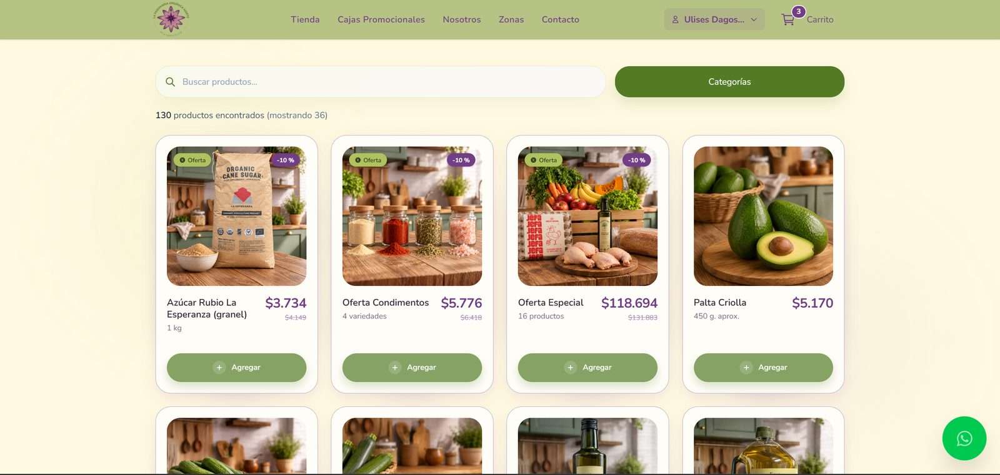
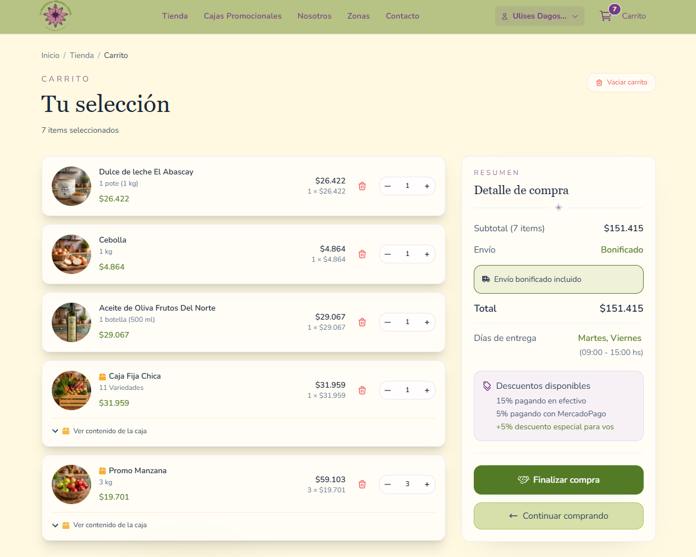
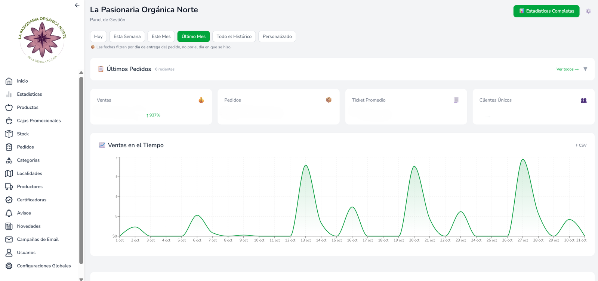

# La Pasionaria Orgánica Norte — E-commerce Case Study

Online store and operations platform for an organic food delivery business in the north of Greater Buenos Aires. It replaced an unstable website and a manual process, and now runs sales, stock, payments, deliveries and email marketing.

**Live site:** [lapasionariaorganicanorte.com.ar](https://lapasionariaorganicanorte.com.ar/)

> The source code is private: it is a client's production system. This repository documents the problem, the architecture and the engineering decisions. **I'm happy to walk through the code in an interview.**


---

## Results

- **100+ registered customers within the first month online**, and **80+ regular customers every week**.
- Stock is updated automatically by every order, cancellation and restock, instead of by hand.
- No more outages: the previous site went down constantly.
- The team can now reach its customers with **email campaigns** built and sent from the admin panel.

## The problem

Before this project the business:

- Kept **stock by hand**, so it sold products it no longer had.
- Had recurring **problems with customer accounts**.
- Ran on a **server that kept failing**, which took the whole site down.
- Had **no way to communicate** with its customers by email.

On top of that, the business model is not a typical store: retail and **wholesale customers** see different prices and minimum orders, deliveries go out on **specific days per zone**, products are sold loose or inside **promotional boxes** made of other products, and customers pay in **cash, bank transfer or Mercado Pago**, split across several of the owners' accounts.

## My role

Built by a two-person team: me and [Máximo Correa](https://github.com/MaximoCorrea1). We started together for a client we knew, without a formal split of responsibilities, and worked through a shared backlog **by feature and fix, both of us across the whole stack**: database, API, storefront and admin. 600+ commits over a year and a half (May 2025 → today).

---

## What we built

| Area | Features |
|---|---|
| **Storefront** | Catalog with search, categories and infinite scroll · product pages with SEO (JSON-LD `Product`/`Offer`, sitemap) · promotional and offer boxes · delivery zones · Google sign-in |
| **Cart & checkout** | Optimistic cart for guests and logged-in users · live prices and stock revalidation · minimum order and free-shipping progress · delivery date per zone · cash / transfer / Mercado Pago |
| **Customer area** | Order history · edit or cancel a pending order · reschedule delivery · change payment method |
| **Admin panel** | Products, boxes, stock, categories, producers and certifiers · orders (create, edit, print delivery notes in bulk) · customers, balances and debts · zones and delivery days · payment accounts · sales and margin metrics with CSV export |
| **Marketing** | Email campaign editor with templates and audience segmentation · announcements and pop-ups on the storefront |

<table>
  <tr>
    <td></td>
    <td></td>
  </tr>
  <tr>
    <td colspan="2"></td>
  </tr>
</table>

## Architecture

```
 Browser ──▶ Next.js on Vercel (App Router)
               ├─ Server Components + Route Handlers (124 API routes, zod validation)
               ├─ Service layer (orders, cart, pricing, payments, campaigns…)
               ├─ Data Cache with tag invalidation
               └─ Cron jobs: balance recalculation, email campaign sending
                     │
                     ▼
            Supabase (PostgreSQL + Auth + Storage)
               ├─ RLS on every table, column-level grants
               └─ SECURITY DEFINER functions for cart and orders

 External:  Mercado Pago (payments + signed webhooks) · Resend (email + signed webhooks)
            Upstash Redis (rate limiting) · Google Identity Services (sign-in)
```

---

## Engineering decisions

The interesting part of this project was not the number of features, but keeping money and stock correct while the rules kept changing. Some of the decisions:

**1. Orders are created atomically in the database.**
Turning a cart into an order happens in a single Postgres function that locks the product rows (`SELECT … FOR UPDATE`), checks stock, visibility and minimum order, deducts stock and creates the order in one transaction. Two customers can't buy the last unit at the same time.

**2. One definition of price, mirrored in SQL.**
Retail, wholesale, offers and box prices are resolved by a single function in the app and its mirror in SQL, used when the order is confirmed. The rule had been copied in several places and the copies had drifted apart. Prices are **resolved live** instead of being frozen when a product is added to the cart, so a price change is never charged at the old value, and amounts are **truncated at the source** so line totals always add up.

**3. No amount of money comes from the browser.**
Totals, discounts and shipping are always recalculated on the server, including orders created by an admin. The client only sends *what* it wants, never *how much* it costs.

**4. Security model: deny by default.**
Every table has RLS, but an audit showed that Supabase's default grants were too broad for the orders table and that two permissive policies were being combined into a weaker one. We revoked the write grants and moved **every order write to the server**, with ownership checked explicitly. Public catalog columns are exposed through **column-level grants**. Webhooks from Mercado Pago and Resend are **signature-verified**, payment requests carry **idempotency keys**, and sign-in is **rate-limited**.

**5. Promotional boxes with exact stock restoration.**
A box is made of other products. When it is sold, each component's stock is deducted (never below zero) and the system records exactly how much was deducted, so that cancelling the order restores **that amount**, not a recalculated one. Restoring a recalculation would create stock that never existed.

**6. Payments split across several Mercado Pago accounts.**
Account credentials live in the database, not in environment variables, so the owners can manage them from the admin. Card payments go to the default account and bank transfers are **automatically balanced** to the least-loaded account (money collected this month plus transfers still pending).

**7. Business dates in Argentina's time zone.**
Vercel runs in UTC and Argentina is UTC−3, so for three hours every night "today" on the server was already tomorrow. All business dates (delivery windows, order cut-off times, weekly metrics) are anchored to Argentina's time zone, on the server and in the browser.

**8. Email campaigns that fail closed.**
Campaigns are sent by a cron job in batches through Resend, with per-recipient personalization, a daily sending cap, and a suppression list fed by bounce and complaint webhooks. If the system can't read how many emails it already sent, or who unsubscribed, it **sends nothing** rather than guessing.

**9. Fresh data without hammering the database.**
The catalog is cached with Next.js Data Cache and invalidated by tags: admin changes and purchases are reflected instantly, the rest within a minute.

**10. Observability.**
Browser errors are reported to the server logs with the stack, the user and whether the tab was running an outdated build; every validation error is logged with the route and field (never the value). A bug that used to be "the page went blank and then it worked" now leaves a trace.

## Working with AI as part of the process

We used **Claude Code** daily, and treated the project's documentation as part of the system:

- A `CLAUDE.md` with the architecture and **30+ "golden rules"**, each one written after a real production bug (for example *"no amount of money comes from the browser"* or *"a read error is not a zero"*), so neither we nor the AI repeat the same mistake.
- A per-system reference, a changelog and a database reference kept up to date with every change.
- **15 regression check scripts** (`npm run checks`) that verify the critical rules against the real database: price rounding, catalog ordering, delivery cut-off times, campaign content, anonymous access.

## Tech stack

| Layer | Technologies |
|---|---|
| Frontend | Next.js 15 (App Router), React 19, Tailwind CSS 4, Recharts |
| Backend | Next.js Route Handlers, zod, service layer |
| Database & auth | Supabase: PostgreSQL, RLS, SQL functions and triggers, Auth (email + Google), Storage |
| Payments | Mercado Pago (Checkout Pro, multiple accounts, webhooks) |
| Email | Resend, React Email, svix webhook verification |
| Infrastructure | Vercel (hosting, cron jobs), Upstash Redis (rate limiting), sharp (image processing) |

## By the numbers

| | |
|---|---|
| Commits | 600+ |
| API routes | 124 |
| Pages | 66 |
| Versioned database migrations | 41 |
| Documented systems | 30 |
| Regression checks | 15 |

---

**Ulises D'Agostino** · Fullstack developer · [GitHub](https://github.com/Momosno)
